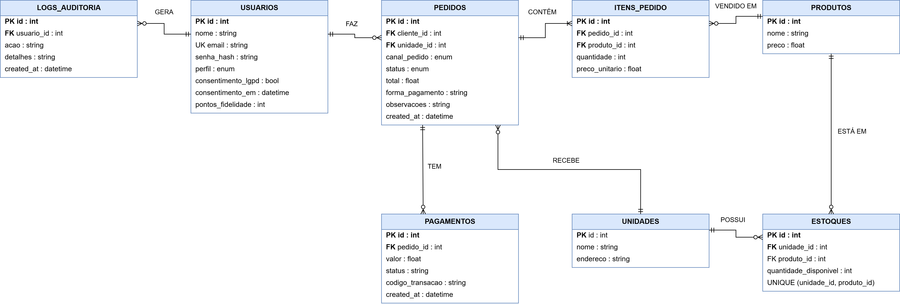

# API Raízes do Nordeste

Projeto Multidisciplinar, trilha Back-end. API REST feita com FastAPI, SQLAlchemy (ORM) e SQLite para a rede de lanchonetes Raízes do Nordeste. Ela permite fazer pedidos por vários canais (`APP`, `TOTEM`, `BALCAO`, `WEB` e `PICKUP`), controla o estoque de cada unidade, dá pontos de fidelidade aos clientes e simula o pagamento (mock). A autenticação é feita com JWT e cada perfil (`CLIENTE`, `ATENDENTE`, `COZINHA` e `GERENTE`) só acessa o que tem permissão.

- **Repositório:** https://github.com/KaickRB/raizes-nordeste-api
- **Swagger local:** http://127.0.0.1:8000/docs
- **Coleção de testes:** [`testes.json`](https://github.com/KaickRB/raizes-nordeste-api/blob/main/testes.json) (Postman)
- **DER do banco:** [`docs/der.png`](https://github.com/KaickRB/raizes-nordeste-api/blob/main/docs/der.png)

## Requisitos
Python 3.10 ou superior e pip. As bibliotecas necessárias estão no `requirements.txt` (FastAPI, Uvicorn, SQLAlchemy, Pydantic, PyJWT, bcrypt, python-dotenv e email-validator). O banco de dados usado é o SQLite, que já vem com o Python, e o arquivo `raizes.db`, que é criado sozinho ao executar o código.

## Como rodar

```bash
# 1. ambiente virtual
python -m venv venv
venv\Scripts\activate          # Windows (PowerShell: .\venv\Scripts\Activate.ps1)
source venv/bin/activate       # Linux/Mac

# 2. dependências
pip install -r requirements.txt

# 3. variáveis de ambiente
cp .env.example .env           # Windows: copy .env.example .env
# abra o .env e troque o valor de SECRET_KEY

# 4. iniciar a API (as tabelas são criadas automaticamente)
uvicorn main:app --reload
```

A API fica em http://127.0.0.1:8000. O `.env` com a `SECRET_KEY` não vai para o repositório (está no `.gitignore`).

O banco é criado automaticamente quando a API inicia (o SQLAlchemy cria as tabelas a partir do `models.py`). Não há migrations porque o projeto é pequeno. Se mudar alguma tabela, apague o `raizes.db` e suba a API de novo.

### Seed (dados de teste)
Com a API rodando, chame `POST /seed` (pelo Swagger ou Postman). Ele cria 2 unidades, 2 produtos, o estoque e 4 usuários com a senha `senha123`:

| E-mail | Perfil |
|---|---|
| joao@gmail.com | CLIENTE |
| gerente@raizes.com | GERENTE |
| cozinha@raizes.com | COZINHA |
| atendente@raizes.com | ATENDENTE |

A filial de Olinda só vende tapioca, e a matriz vende tapioca e cuscuz.

## Como usar o Swagger
Com a API rodando, abra http://127.0.0.1:8000/docs. Chame o `POST /auth/login`, copie o `access_token`, clique em **Authorize** e cole só o token, sem o e-mail e sem a palavra `Bearer`. Depois disso as rotas protegidas já podem ser testadas por lá.

## Como rodar os testes
1. Suba a API com o banco **vazio** (apague o `raizes.db` antes de iniciar o uvicorn) e deixe o servidor rodando.
2. No Postman, importe o `testes.json`. O endereço da API já está na variável `baseUrl` (`http://127.0.0.1:8000`).
3. Clique na coleção, depois em **Run**, e rode tudo na ordem (00, 01 e 02). A primeira requisição (S0) faz o seed.

São 15 requisições, em pastas, com testes automáticos. As três primeiras (S0 a S2) preparam o ambiente: seed, login do gerente e um pedido extra para o teste de pagamento recusado. Os tokens e ids dos pedidos são salvos sozinhos em variáveis. Os 12 cenários são:
- **Positivos:** login do cliente (T01), criar pedido (T02), filtro por canal (T03), pagamento aprovado (T04), pagamento recusado (T05) e auditoria (T06).
- **Negativos:** 401 sem token (T07), 403 sem permissão (T08), 422 sem `canalPedido` (T09), 422 quantidade negativa (T10), 404 produto inexistente (T11) e 409 estoque insuficiente (T12).

## Endpoints

| Método | Rota | Quem acessa | Códigos |
|---|---|---|---|
| POST | /auth/login | público | 200, 401, 422 |
| POST | /usuarios/ | público (exige consentimento LGPD) | 201, 409, 422 |
| GET | /usuarios/me | logado | 200, 401 |
| DELETE | /usuarios/me | logado (anonimiza a conta) | 200, 401 |
| GET | /usuarios/me/pontos | logado | 200, 401 |
| POST | /usuarios/me/resgatar-pontos | logado | 200, 401, 409, 422 |
| GET | /unidades/?page=&limit= | público | 200 |
| GET | /unidades/{id}/cardapio | público | 200, 404 |
| POST | /pedidos/ | logado | 201, 401, 404, 409, 422 |
| GET | /pedidos/?canalPedido=&status=&page=&limit= | logado (cliente vê só os seus) | 200, 401, 422 |
| GET | /pedidos/{id} | dono, atendente, gerente | 200, 401, 403, 404 |
| PATCH | /pedidos/{id}/status | cozinha, atendente, gerente | 200, 401, 403, 404, 409 |
| POST | /pedidos/{id}/cancelar | dono, atendente, gerente | 200, 401, 403, 404, 409 |
| POST | /pagamentos/ | dono, atendente, gerente | 201, 401, 403, 404, 409, 422 |
| POST | /estoque/entrada | gerente | 200, 401, 403, 404, 422 |
| GET | /estoque/{unidade_id} | gerente, atendente | 200, 401, 403, 404 |
| GET | /auditoria/?page=&limit= | gerente | 200, 401, 403 |

Exemplos de request e response estão no Swagger (`/docs`). Todo erro segue o mesmo formato:

```json
{
  "error": "ESTOQUE_INSUFICIENTE",
  "message": "Produto 1 sem estoque nesta unidade.",
  "details": [],
  "timestamp": "2026-10-18T11:00:00+00:00",
  "path": "/pedidos/"
}
```

## Fluxo principal (Fluxo A)
1. O cliente faz login e cria o pedido (`AGUARDANDO_PAGAMENTO`). O estoque da unidade é descontado.
2. `POST /pagamentos/`: aprovado vai para `PAGO` e o cliente ganha pontos; recusado vai para `CANCELADO` e o estoque volta.
3. A cozinha avança `PREPARANDO` → `PRONTO` → `ENTREGUE`. Fora dessa ordem, retorna 409.
4. Cada ação sensível grava um registro em `logs_auditoria`.

## Organização do código

| Camada | Arquivos |
|---|---|
| API | `routers/`, `schemas.py`, `main.py` |
| Application | `services.py` |
| Domain | `models.py` |
| Infrastructure | `database.py`, `security.py` |

## Banco de dados (DER)


O banco tem 8 tabelas: `usuarios`, `unidades`, `produtos`, `estoques`, `pedidos`, `itens_pedido`, `pagamentos` e `logs_auditoria`. Um usuário faz vários pedidos e gera vários logs. Uma unidade recebe pedidos e possui estoques. O pedido contém itens e tem pagamentos, e o produto aparece nos itens e no estoque de cada unidade. O estoque tem `UNIQUE (unidade_id, produto_id)`.

## Propostas futuras
O fluxo principal foi priorizado, e o que ficou como proposta é:
- **Promoções:** campanhas com nome, percentual de desconto, datas e unidade, aplicadas ao total do pedido.
- **Relatórios:** consultas de vendas por unidade e por canal.
- **Desempenho:** trocar o SQLite por PostgreSQL para ampliar a escalabilidade.
- **Distribuição inteligente de pedidos:** direcionar os pedidos online para a unidade mais próxima do cliente. Se ela estiver com alta demanda, o pedido iria para a segunda mais próxima, e, se não for viável, ficaria na mais próxima mesmo. Isso exigiria guardar a localização das unidades e dos clientes e contar os pedidos em andamento de cada unidade.

## Segurança
- Senha guardada com hash (bcrypt), e as respostas nunca mostram o `senha_hash`.
- Login com JWT, que expira em 60 minutos.
- Autorização por perfil: cada rota só aceita os perfis indicados na tabela de endpoints (erro 403 para os outros).
- `SECRET_KEY` no `.env`, que não vai para o repositório.

## LGPD
- **Dados coletados:** nome, e-mail e senha (só o hash). Nenhum dado de cartão é guardado, porque o pagamento é simulado.
- **Finalidade:** identificar o cliente, registrar os pedidos e controlar os pontos de fidelidade.
- **Base legal e consentimento:** o cadastro só é feito se o cliente aceitar os termos (`consentimento_lgpd`), e a data do aceite fica salva em `consentimento_em`. Sem o consentimento a API retorna erro 422.
- **Anonimização:** `DELETE /usuarios/me` troca nome e e-mail por valores genéricos, gera uma senha aleatória (ninguém mais entra na conta) e remove o consentimento. Os pedidos continuam no banco, só que sem os dados pessoais.
- **Auditoria:** login, criação de pedido, pagamento, mudança de status, cancelamento, resgate de pontos, entrada de estoque e anonimização geram um registro em `logs_auditoria`, que só o gerente consegue ver.
